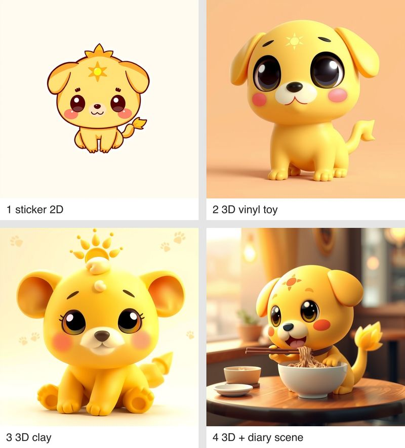
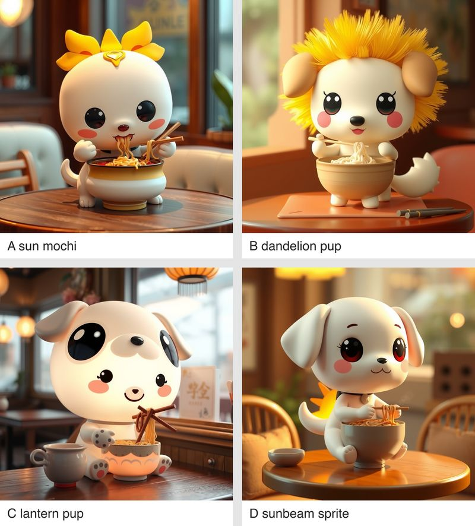

# Plan: CRAFTJAI v2 concept (life picture book + self-reflection mirror)

**Date:** 2026-11-24
**Status:** Concept agreed, character design next
**Source:** Brainstorm session after reviving the app locally (Supabase restored, image generation moved to Cloudflare)

## 1. Core goal

CRAFTJAI is a **life picture book** and a **mirror for self-reflection**. These two were the goal from the start.

Gamification is a **tool**, not the goal. It exists to fix one pain point: people find it hard to keep writing a diary ("ขี้เกียจเขียน"). Every game mechanic must answer one question: *does this make people write?*

**Job to be done:**
When I end the day with feelings I cannot name yet, I want to put them somewhere that answers back, so I feel heard and can slowly see which feelings visit me most.

## 2. Product shape: 3 layers + glue

```
Write (low friction)  ->  Picture (life picture book)  ->  Reflect (mirror)
        ^______________ gamification brings people back to write ______________|
```

| Layer | What the user gets | Exists today |
|---|---|---|
| Write | Chat with JaiD (3 guiding questions) or free write, TH/EN | Yes |
| Picture | One illustrated scene per entry, built from diary details | Partly (character + background, style to update) |
| Reflect | Patterns over time: which moods, when, how often | Partly (calendar + mood distribution) |

## 3. Gamification principles

1. **Reward the act of writing, not the mood.** Every entry gives one scene. The pull is curiosity: "what will today's picture look like?" (maps to the paper's *unpredictability and curiosity* criterion).
2. **Deeper writing gives a richer picture.** Details from the diary become objects in the scene (see the noodle cafe example below). Depth is visible, not just a rarity number.
3. **Progress is a book, not a catch-them-all list.** "Your book has 23 pages." Each month closes as a chapter with a mirror recap, for example "Luna visited 9 times this month, mostly late at night." This links the picture book and the mirror into one loop.
4. **Bond with characters.** A character that visits often grows (evolution). No punishment for missed days: the book simply pauses.
5. **Collection is a side effect.** "Which feelings have visited you" lives on the mirror page, not as the main screen pushing completion.
6. **Lower the starting friction.** Keep JaiD chat. Later options: one-line quick entry, voice input.

**Guardrail:** never lock a reward to a specific mood (for example "you need an angry entry to complete the set"). That pushes users to fake moods and breaks the mental health goal.

## 4. Riskiest assumption and cheapest test

**Assumption:** people who are lazy to write will come back because they want the picture.

The paper measured *motivation to collect* (all metrics above 80%), not whether people *write more often*.

**Test:** 5 friends use the app for 1 week. Count writing days per person and compare with a plain notes app. Needs a deployed demo (see open items).

## 5. Character design brief

### Decisions so far

- **Style: 3D vinyl art toy chibi inside the diary scene** (option 4 below). The user liked it because the scene reflects diary details.
- **Original creatures only.** No Pokémon characters or look-alikes, even for non-commercial use: the repo is public and tied to the paper.
- **Keep the paper's 8 mood to animal and color mapping** for research continuity (Joy yellow dog, Trust light green bear, Fear dark green rabbit, Sadness dark blue cat, Surprise light blue bird, Disgust purple rat, Anger red tiger, Anticipation orange fox).
- Make each creature **inspired by** its animal, not a real breed (current prompt says "golden retriever puppy", which is why results look like plain puppies).



### Creature design rules (apply to all 8)

1. **1 to 2 cues from the animal** (for example snout and floppy ears) so the origin is still readable.
2. **Body features from the element** (for example a sunray mane, petal ears) so it reads as a new creature.
3. **Locked main color from the paper's mapping**, and the same color is used for that mood in mirror charts.
4. **One fixed description per character**, reused in every prompt, plus a short "never" list (for example no collar, no clothing).
5. **Pose and expression carry mood intensity** (arousal), the scene carries diary context.

Characters are "the same friend on every page", so visual consistency is a core requirement, not a nice-to-have.

### Joy concept round (dog + sun)



| Concept | Result |
|---|---|
| A sun mochi | Round mochi body, sunflower-petal ears, sun gem. Reads as original, still a hint of dog. **Candidate** |
| B dandelion pup | Puppy face with a glowing golden dandelion / sunray mane. Most recognizable element. **Candidate** |
| C lantern pup | Model failed (double face) |
| D sunbeam sprite | Model ignored the floating sunlight body |

All four came out white because the prompt left out "golden yellow". Fix the color in the next round.

## 6. Image generation setup

- `src/lib/image-gen/generate-image.ts` now calls **Cloudflare Workers AI** `@cf/black-forest-labs/flux-1-schnell` (free daily allocation). Hugging Face hf-inference dropped FLUX.1-schnell (HTTP 410) and the HF account has no provider credits.
- Env: `CLOUDFLARE_ACCOUNT_ID`, `CLOUDFLARE_API_TOKEN`, optional `CLOUDFLARE_IMAGE_MODEL`.
- API notes: body is `{ prompt, steps }` with steps up to 8; `seed` is rejected; response is JSON with `result.image` as base64.

## 7. Next steps

1. Pick concept direction for Joy (A sun mochi or B dandelion pup), fix color, test the same rules on one more character (Luna, sadness, water).
2. Write character sheets for all 8 (silhouette, animal cues, element features, palette, never list, locked prompt).
3. Update `src/lib/constants/emotions.ts` and the character prompt section in `src/lib/gemini/prompts.ts`.
4. Generate a test entry through the real app flow (uses 1 of the 5 daily characters).
5. Design the "book" and "chapter recap" screens (picture book + mirror loop).

## 8. Open items (parked)

- Current streak stays at 1 after 7 months without entries (streak only updates on new entries).
- All 6 existing characters are Uncommon with the same power (24); check `src/lib/gamification/rarity.ts`.
- Emoji still used on login, album header, Mood Discovery, rarity breakdown.
- `supabase/migrations/001_initial_schema.sql` still has `unique` on `characters.diary_entry_id`, but the live DB dropped it for multi-mood.
- `src/lib/image-gen/client.ts` and `@huggingface/inference` are unused now.
- Paper LoRA (`krprmf/CRAFTJAI-MoodGen-LoRA`, FLUX.1-dev) is not wired into the app.
- Deploy a demo (Vercel, root `personal/CRAFTJAI`) for the 1-week test. Supabase free tier pauses after 7 idle days.
- Later ideas, not now: daily map with grass encounters, real 3D models (image to GLB), sending a creature to a friend, printed stickers or toys.
