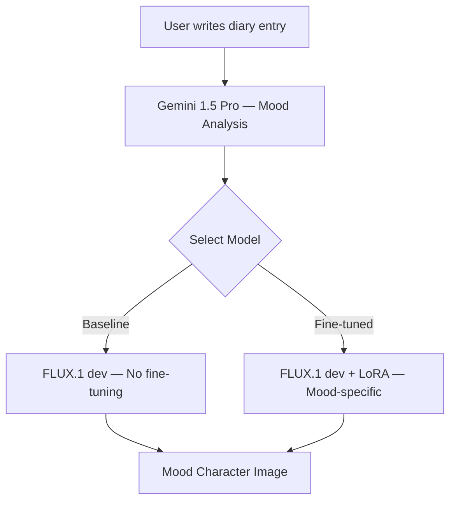
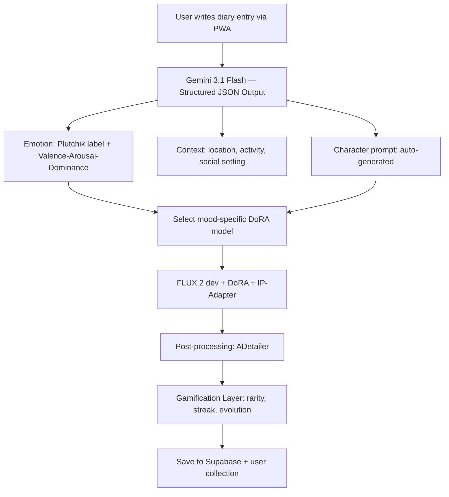

# Research: CRAFTJAI v2 — From Paper to Product

## Summary

CRAFTJAI currently exists **only as a published paper** (IEEE ECTI-CON 2025) and **two Hugging Face artifacts** (1 LoRA model + 1 dataset with 122 images). There is **zero application code** in this repository. Building CRAFTJAI v2 as a product requires creating a full-stack web application from scratch, while upgrading every AI component from the paper (LLM, text-to-image, fine-tuning, emotion model) to 2026 state-of-the-art. The competitive landscape confirms that **no existing app combines diary-to-character generation with collection mechanics** — this is a genuine market gap.

## Architecture & Flow

### Paper's Original Pipeline (2025)



### Proposed v2 Pipeline (2026)



### Proposed App Architecture

```
┌─────────────────────────────────────────────────┐
│                   Frontend                       │
│         Next.js 15 (App Router) + PWA            │
│    Tailwind CSS + shadcn/ui + Framer Motion      │
├─────────────────────────────────────────────────┤
│                   Backend                        │
│            Next.js API Routes / Server Actions   │
├──────────┬──────────┬──────────┬────────────────┤
│ Supabase │ Gemini   │ HF       │ Supabase       │
│ Auth     │ API      │ Inference│ Storage        │
│ (Google  │ (mood    │ API      │ (character     │
│  login)  │ analysis)│ (image)  │  images)       │
├──────────┴──────────┴──────────┴────────────────┤
│              Supabase PostgreSQL                 │
│  users | diary_entries | characters | streaks    │
└─────────────────────────────────────────────────┘
```

## Key Files

### Current State (What Exists)

| File / Resource | Purpose |
|------|---------|
| `CRAFTJAI_LLM-Enhanced_Generative_AI_for_Gamified_Mood_Journals.pdf` | Published IEEE paper (ECTI-CON 2025) |
| `CRAFTJAI_v2_research.md` | Technology upgrade research (created this session) |
| [krprmf/CRAFTJAI-MoodGen-LoRA](https://huggingface.co/krprmf/CRAFTJAI-MoodGen-LoRA) | Fine-tuned LoRA model on FLUX.1-dev, 8 moods, safetensors format, trained via fal.ai |
| [krprmf/CRAFTJAI-MoodCharacter-Dataset](https://huggingface.co/datasets/krprmf/CRAFTJAI-MoodCharacter-Dataset) | 122 curated images (1024x1024), 8 emotion classes, Parquet format |
| [CRAFTJAI Collection on Hugging Face](https://huggingface.co/collections/krprmf/craftjai) | Collection page linking model + dataset (last updated Apr 2025) |

### What Needs to Be Built (No Code Exists Yet)

| Component | Files to Create | Purpose |
|------|---------|---------|
| Next.js app scaffold | `package.json`, `next.config.js`, `tsconfig.json`, `tailwind.config.ts` | Project foundation |
| PWA config | `manifest.json`, `service-worker.js` | Installable on mobile |
| Auth | `app/login/page.tsx`, `utils/supabase/client.ts`, `utils/supabase/server.ts` | Google login via Supabase Auth |
| Diary entry | `app/diary/page.tsx`, `app/api/diary/route.ts` | Write & submit diary entries |
| Mood analysis | `lib/gemini.ts` | Gemini API call with structured JSON output |
| Image generation | `lib/huggingface.ts` | HF Inference API call to FLUX model + LoRA |
| Collection gallery | `app/collection/page.tsx` | View all collected mood characters |
| Character detail | `app/character/[id]/page.tsx` | View individual character with diary context |
| Gamification logic | `lib/gamification.ts` | Rarity, streaks, evolution rules |
| Database schema | `supabase/migrations/` | Tables for users, entries, characters, streaks |

## Existing Patterns & Conventions

### From the Paper

- **Emotion taxonomy:** Plutchik's Wheel of Emotions — 8 core emotions mapped to animal characters and colors:
  - Joy → Yellow Dog | Trust → Light Green Bear | Fear → Dark Green Rabbit | Sadness → Dark Blue Cat
  - Surprise → Light Blue Bird | Disgust → Purple Rat | Anger → Red Tiger | Anticipation → Orange Fox
- **Prompt structure:** 4-section template (Word Slot definitions, LLM mood extraction, LLM diary simulation, Text-to-Image character prompt)
- **LLM reasoning:** Chain-of-Thought + Few-shot learning for prompt refinement
- **Dataset curation:** 6-step framework (analyze → generate 3 descriptions → reformat → evaluate → select best → map to character/color)
- **Fine-tuning:** LoRA rank 16, lr 0.0005, 1000 steps, boost factor 3.0, with mask generation
- **Training platform:** fal.ai (flux-lora-fast-training)
- **Evaluation:** 5-point Likert scale, 35-70 participants per mood, 384 total images (192 per method)

### From the Hugging Face Artifacts

- **Model format:** safetensors (compatible with diffusers library)
- **Dataset format:** image folder auto-converted to Parquet, fields: `image`, `label` (0-7)
- **Dataset naming convention:** `{Emotion}-{Color}{Character}` (e.g., `Joy-YellowDog`, `Anger-RedTiger`)
- **Image resolution:** 1024 x 1024 pixels
- **Dataset distribution:** ~13-18 images per emotion (122 total, uneven distribution)

## Findings

### 1. AI Model Upgrades Available

**LLM (Mood Analysis):**
- Gemini 1.5 Pro (paper) → **Gemini 3.1 Flash** or **Gemini 2.5 Flash** (free tier, 15 RPM)
- Structured JSON output now native in Gemini API via `responseSchema` — eliminates parsing errors entirely
- Works with Pydantic (Python) or Zod (TypeScript) schema validation out-of-the-box
- Multimodal capability added: can analyze text + images + audio (future: voice journaling)
- Budget alternatives: DeepSeek V3 ($0.27/MTok), Claude Haiku 4.5 ($1/MTok)

**Text-to-Image:**
- FLUX.1 [dev] (paper) → **FLUX.2 [dev]** (released Nov 2025, 32B params)
- Key improvements: multi-reference consistency (up to 10 images), better typography, up to 4MP output, improved hands/faces
- **FLUX.2 [klein]** (4B) runs on consumer GPUs (~13GB VRAM) — viable for local inference
- FLUX.1 [schnell] remains available for fast/free generation (Apache 2.0 license)
- HF Inference API provides free access to FLUX models

**Fine-tuning:**
- LoRA rank 16 (paper) → **DoRA** (Weight-Decomposed Low-Rank Adaptation)
- DoRA: ICML 2024 Oral (1.5% acceptance rate), decomposes weights into magnitude + direction
- Achieves 90-95% of full fine-tuning quality vs LoRA's 80-85%
- Zero additional inference overhead — drop-in replacement for LoRA
- Experimental support in diffusers library for text-to-image models
- Recommended: DoRA rank 24-32, same lr 0.0005, increase to 1500-2000 steps

**Character Consistency (NEW capability):**
- IP-Adapter for FLUX.1-dev exists ([InstantX/FLUX.1-dev-IP-Adapter](https://huggingface.co/InstantX/FLUX.1-dev-IP-Adapter))
- XLabs-AI flux-ip-adapter-v2 available for FLUX models
- Enables same character face/style across multiple generations — critical for collection mechanic
- FLUX.2 natively supports multi-reference consistency (up to 10 reference images)
- Known limitation: IP-Adapter + ControlNet together can "break" consistency at high weights

**Emotion-Conditioned Generation (NEW capability):**
- [EmotiCrafter](https://arxiv.org/abs/2501.05710) (Jan 2025, accepted ICCV 2025): embeds Valence-Arousal values directly into text features
- Enables continuous emotional control beyond discrete prompt adjectives
- Addresses the paper's identified weakness: poor visual appeal for negative emotions (disgust, fear)
- Open-source: [github.com/idvxlab/EmotiCrafter](https://github.com/idvxlab/EmotiCrafter)

### 2. Emotion Model Enhancement

- Paper uses 8 discrete categories only → can add **Valence-Arousal-Dominance** as continuous layer
- Valence (-1 to +1): positive ↔ negative → maps to color saturation / character expression intensity
- Arousal (0 to 1): calm ↔ excited → maps to character pose (sitting vs action)
- Dominance (0 to 1): submissive ↔ dominant → maps to "power level" for gamification
- Geneva Emotion Wheel (Scherer) provides situational context not in Plutchik's model
- Backward compatible: keep Plutchik 8 as primary labels, add V-A-D as metadata

### 3. Competitive Landscape

| App | AI Art | Collection | Gamification | Diary-to-Character |
|-----|--------|------------|-------------|-------------------|
| Rosebud | No | No | Streaks only | No |
| Mindsera | No | No | Coaching | No |
| Dayora | No | No | Basic | No |
| BOMI | Fixed companion | No | Fortune | No (fixed character) |
| eQuoo | No | No | Strong | No |
| Life Note | No | No | AI mentors | No |
| **CRAFTJAI v2** | **AI-generated** | **Yes** | **Full system** | **Yes (core feature)** |

**CRAFTJAI v2 would be the only app combining all four columns.** No direct competitor found.

### 4. App Architecture Findings

**Recommended Stack (all free tier):**
- **Next.js 15** (App Router): SSR + API routes + PWA support built-in via `manifest.ts`
- **Supabase**: Free tier includes Auth, PostgreSQL (500MB), Storage (1GB), 50K monthly active users
- **Tailwind CSS + shadcn/ui**: Fast UI development, mobile-responsive by default
- **Vercel**: Free hosting for Next.js, automatic HTTPS, `*.vercel.app` domain

**Offline-first pattern available:** IndexedDB as local source of truth → sync queue → Supabase (Jan 2026 pattern documented in Medium article). This means users can write diary entries offline.

**PWA support:** Next.js App Router has built-in `manifest.ts` file support — no additional libraries needed for basic PWA.

### 5. Dataset Limitations

- Current dataset: only **122 images** across 8 moods (~15 per mood) — small for fine-tuning
- Distribution is uneven (7-18 images per class)
- No text prompts included in dataset — only images + integer labels
- For DoRA fine-tuning on FLUX.2, recommend **200-400 images** with paired text descriptions
- Can use LLM to generate additional training prompts (same pipeline as paper Section III-B)

### 6. Cost Analysis (Monthly, Free Tier)

| Service | Free Tier Limit | Sufficient for MVP? |
|---------|----------------|-------------------|
| Supabase | 500MB DB, 1GB storage, 50K MAU | Yes (images stored as URLs) |
| Gemini API | 15 RPM, 1M TPM | Yes (~400 diary analyses/day) |
| HF Inference API | Rate-limited, queue-based | Yes for demo (slow, ~30s/image) |
| Vercel | 100GB bandwidth, serverless functions | Yes |
| **Total** | **$0/month** | **Yes for MVP + demo** |

**Bottleneck:** HF Inference API is slow for image generation (~30s+ per image). For production, fal.ai offers pay-per-use (~$0.01-0.05/image) or self-hosted GPU via RunPod/Vast.ai (~$0.20-0.50/hour).

## Risks & Edge Cases

1. **HF Inference API reliability:** Free tier is queue-based with no SLA — image generation can timeout or be very slow during peak hours. May need fallback or loading UX that manages expectations.

2. **LoRA → DoRA migration:** DoRA for diffusion models is "experimental" per official docs. Hyperparameters that work for LoRA may not transfer directly. Needs empirical testing.

3. **IP-Adapter + LoRA/DoRA stacking:** Known issue where IP-Adapter with high weight "breaks" consistency when combined with ControlNet on FLUX models. Careful weight balancing required.

4. **Dataset size:** 122 images is small. DoRA on FLUX.2 may need 200-400+ images for reliable style consistency. May need to generate more training data before fine-tuning.

5. **Negative emotion characters:** Paper explicitly identifies disgust and fear characters as "less visually appealing." EmotiCrafter's V-A embedding may help but is unproven for cartoon character generation specifically.

6. **FLUX.2 LoRA/DoRA compatibility:** The existing CRAFTJAI-MoodGen-LoRA was trained on FLUX.1-dev. It will **not** be directly compatible with FLUX.2-dev — retraining required.

7. **Supabase storage:** Free tier is 1GB. At 1024x1024 PNG (~1-3MB each), that's only ~300-1000 characters before hitting the limit. Need to compress to WebP (~100-200KB) or use external CDN.

8. **Gacha ethics:** 2025 research shows reward frequencies >55 sessions trigger compulsive behaviors. Collection mechanics must be designed to encourage reflection, not addiction.

9. **Data privacy:** Diary entries contain sensitive emotional content. GDPR/PDPA compliance needed. Gemini API sends data to Google servers — need clear user consent and privacy policy.

10. **Single developer scope:** Full MVP (auth + diary + LLM + image gen + collection + gamification) is ambitious for one person. Prioritize core loop first: write → generate → view collection.

## Open Questions

1. **Which FLUX.2 variant for HF Inference?** — Need to verify if FLUX.2 [dev] is available on HF free Inference API, or if only FLUX.1 [schnell] is free. This determines whether v2 can use the latest model at zero cost.

2. **DoRA support in fal.ai?** — The paper's LoRA was trained via fal.ai. Does fal.ai support DoRA training now? If not, what's the best free/cheap alternative for fine-tuning? (Could use HF AutoTrain or local training with diffusers.)

3. **EmotiCrafter integration feasibility:** — The paper is accepted at ICCV 2025 and code is on GitHub, but is it compatible with FLUX.2? It was designed for Stable Diffusion. May require adaptation.

4. **IP-Adapter for FLUX.2?** — IP-Adapter exists for FLUX.1-dev (InstantX). Need to verify FLUX.2 compatibility or if a new adapter has been released.

5. **User's Thai language support:** — Diary entries will likely be in Thai. Gemini handles Thai well, but need to confirm structured JSON output works reliably with Thai input text.

6. **Target audience for product:** — Paper tested with university students. Is v2 targeting the same demographic, broader public, or specific mental health use cases? This affects design decisions.

7. **Monetization model (if any):** — Free tier constraints limit growth. If the app gains traction, what's the sustainability plan? Freemium? Premium characters? Donation-based?

8. **Existing LoRA reuse strategy:** — Can the 8 existing FLUX.1-dev LoRA models serve as a starting point for FLUX.2 DoRA training, or must training start from scratch?

---

*Research conducted April 10, 2026. AI landscape changes rapidly — verify model availability and pricing before implementation.*

Sources:
- [CRAFTJAI-MoodGen-LoRA on Hugging Face](https://huggingface.co/krprmf/CRAFTJAI-MoodGen-LoRA)
- [CRAFTJAI-MoodCharacter-Dataset on Hugging Face](https://huggingface.co/datasets/krprmf/CRAFTJAI-MoodCharacter-Dataset)
- [CRAFTJAI IEEE Paper](https://ieeexplore.ieee.org/document/11100407/)
- [FLUX.2 dev on Hugging Face](https://huggingface.co/black-forest-labs/FLUX.2-dev)
- [DoRA: Weight-Decomposed Low-Rank Adaptation (ICML 2024)](https://arxiv.org/abs/2402.09353)
- [EmotiCrafter (ICCV 2025)](https://arxiv.org/abs/2501.05710)
- [IP-Adapter for FLUX.1-dev](https://huggingface.co/InstantX/FLUX.1-dev-IP-Adapter)
- [Gemini API Structured Output](https://ai.google.dev/gemini-api/docs/structured-output)
- [Next.js PWA Guide](https://nextjs.org/docs/app/guides/progressive-web-apps)
- [Supabase + Next.js Quickstart](https://supabase.com/docs/guides/getting-started/quickstarts/nextjs)
- [Offline-First PWA with Next.js + Supabase](https://oluwadaprof.medium.com/building-an-offline-first-pwa-notes-app-with-next-js-indexeddb-and-supabase-f861aa3a06f9)
- [Best Open-Source Image Generation Models 2026](https://www.bentoml.com/blog/a-guide-to-open-source-image-generation-models)
- [Gemini API Pricing 2026](https://www.metacto.com/blogs/the-true-cost-of-google-gemini-a-guide-to-api-pricing-and-integration)
- [Gacha Mechanics and Gambling Behavior (2025)](https://arxiv.org/pdf/2504.00057)
